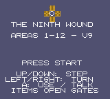
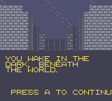
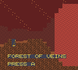
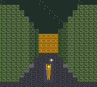
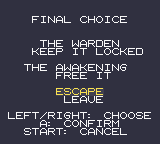
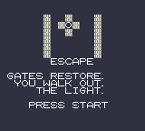

# The Ninth Wound

*A dark first-person puzzle-adventure for Game Boy Color.*

You wake in the dark, beneath the world, with no memory of how you got there.

The people here call this place the Nine Hells. Villages, temples, marketplaces, and whole civilizations have grown up underground, and most of the people living here believe they are already in Hell. Few of them even believe a surface world exists.

But as you explore deeper, things stop adding up. The rivers pulse. The walls sometimes feel warm. Certain tunnels seem to breathe. Ancient records whisper a terrifying truth: Hell is not a place. Hell is a living thing — a colossal imprisoned being sleeping beneath reality, and every region, village, dungeon, forest, and cathedral may merely be part of its body.

Uncover the truth, solve the mysteries of the ancient gate network, and in the end decide for yourself: does the Sleeper stay imprisoned, does it awaken, or do you escape and leave it all behind?

## How to play

The Ninth Wound is an exploration-first, puzzle-first adventure. There is no combat, no leveling, and no grinding — just discovery, observation, navigation, and environmental puzzles. Progress comes from items: find something important, remember where you saw a place that needed it, and go back when you have it.

- **Up** — step forward
- **Down** — step back
- **Left / Right** — turn 90°
- **A** — interact, talk, use, advance dialog
- **Start** — inventory (paged — use Left / Right to flip pages)
- **Select** — minimap with fog of war, showing the name of the area you are in

Movement is instant, tile by tile, in the classic first-person dungeon-crawler style. Gates preserve the direction you are facing. When you first cross a newly unlocked gate, the new area's name appears on screen — and on the minimap, so you always know where you are.

Watch for locked chambers and merchants in earlier areas: some things cannot be opened or bought until you return with a key item from a later area. Backtracking is part of the journey, just like the best old dungeon crawlers.

The crypt door needs a code — the epitaph in the Burial Maze holds it. When you reach the door, you will be asked to enter it.

## The twelve areas

One long descent, connected gate to gate:

1. **The Gatehouse** → 2. **Ash Village** → 3. **Burial Maze** → 4. **Forest of Veins** → 5. **Cathedral of Teeth** → 6. **Blood River** → 7. **Flesh Market** → 8. **Lung Gardens** → 9. **Bone Labyrinth** → 10. **Memory Vault** → 11. **Heart Chamber** → 12. **Throne of the Sleeper**

And the journey doubles back on itself, too:

- A chamber in the **Forest of Veins** stays locked until you carry the Bone Tuning Fork — inside it waits the Vein Organ, needed in the Heart Chamber.
- A chamber in the **Cathedral of Teeth** stays locked until you carry the Lung Bellows — inside it waits the Binding Thread, needed to forge the final key.
- A merchant in the **Flesh Market** will trade a Market Key only for gold found in the Bone Labyrinth — and that key, together with the Heart Key, opens the gate to the Throne.

## Items and relics

Everything you can collect on the way down:

- Rusted Cog, Iron Pin, Gate Seal
- Bronze Sigil
- Ash Lantern
- Grave Seal 1, Grave Seal 2, Grave Seal 3
- Ancient Key Fragment
- Blood Sigil
- Bone Tuning Fork
- River Seal
- Blood Amber, Pale Idol
- Eye Lens
- Lung Bellows
- Silver Sigil
- Bone Seal 1, Bone Seal 2, Bone Seal 3, Bone Seal 4
- Gold Ingot, Market Key
- Heart Seal, Heart Key
- Vein Organ, Binding Thread
- The Ninth Key — forged at the Throne from the Bronze Sigil, Silver Sigil, Heart Seal, Ancient Key Fragment, River Seal, and Binding Thread

## Endings

At the Throne of the Sleeper, with the Ninth Key in hand, the choice is yours:

- **The Warden** — keep the Sleeper imprisoned
- **The Awakening** — free the Sleeper
- **Escape** — restore the gate network and leave forever

## Screenshots

## Play it

Download the ROM from [`build/ninth-wound.gbc`](build/ninth-wound.gbc) and play it in any Game Boy Color emulator (the game is built for Game Boy Color).

## Build it

The source is in `src/` (GBDK C), with `build.sh` and `gen_tiles.py`. Run `./build.sh` with GBDK installed to rebuild the ROM. The headless playthrough checks live in `qa/playthrough.py`.

*Designer — The Ninth Wound*
